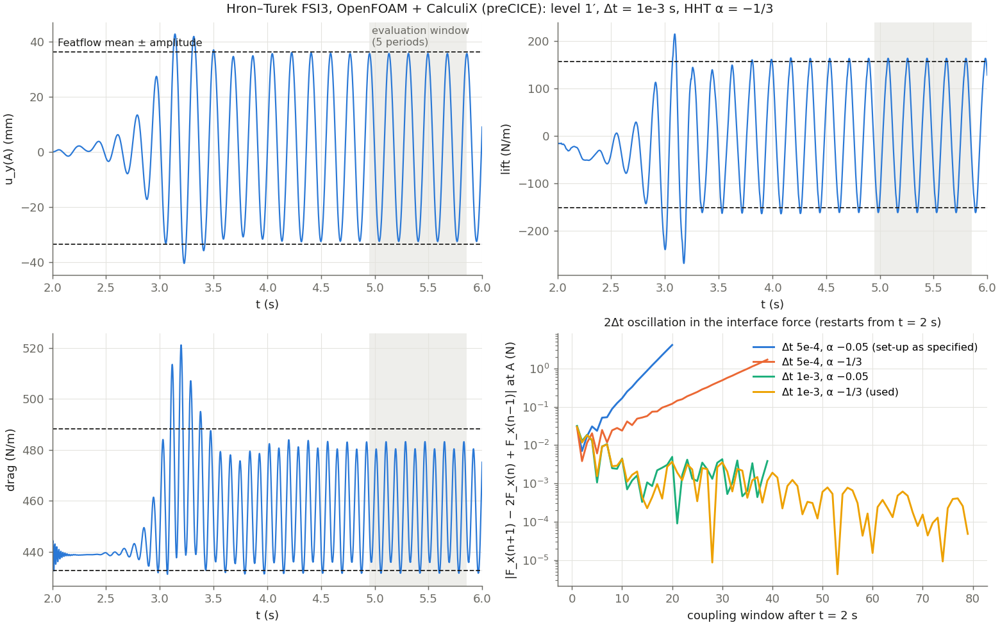

# Hron–Turek FSI3 with preCICE: OpenFOAM fluid + CalculiX solid (November 2026)

This is an independent-solid solution of FSI3 (issue #36) at level 1′ only. The solid code and the coupling library are independent of solids4foam. The fluid is OpenFOAM, as in solids4foam, so the route is partly independent.

The set-up follows the solids4foam corrected FSI3 sequence (`hronturek_fsi3_4x_findings.md`, sections 19–21), with two deviations agreed on #75:

- **Δt = 1e-3 s, not 5e-4 s.**
- **CalculiX HHT α = −1/3, not −0.05.**

Neither was a free choice. With the specified Δt and α, the coupled run is unstable. See [Coupling instability at Δt = 5e-4 s](#coupling-instability-at-δt--5e-4-s). Finer levels were not run: this solver pair cannot follow the constant-Courant path of the corrected sequence (Δt 5e-4 on 1x′–4x′), so they would not be comparable.



## Platform

- **Machine:** AMD Ryzen Threadripper 9970X desktop (32 cores, 125 GiB), Ubuntu 24.04.4, GCC 13.3.0, Open MPI 4.1.6.
- **Fluid:** OpenFOAM v2512 `pimpleFoam`, built from source, with the preCICE OpenFOAM adapter 1.4.0.
- **Solid:** CalculiX 2.20 (`ccx_preCICE`, adapter 2.20.2, Ubuntu noble package).
- **Coupling:** preCICE 3.4.1 (Ubuntu noble package).
- **Environment:** `OMP_NUM_THREADS=1`, `OPENBLAS_NUM_THREADS=1` (`scripts/env-precice.sh`). The system FFTW is used, as for FSI1.
- **Load:** no other jobs ran. The load average was 0.05 at the start and 4.6 at the end; the end value is the run's own 4 fluid ranks and the solid (`logs/level1-dt1e-3/log.environment`).

## Set-up

| Item | solids4foam corrected sequence | this run |
|---|---|---|
| Fluid mesh | ring+box family (`ht_mesh_family.py --ring-n 22 --rows-n 16 --tip-n 4 --aft-n 60 --wake-n 70`) | the same script and arguments; 1x′ = 11 764 cells, 168 flag faces |
| Solid | finite volume, (105·s) × (6·s), s = 2 × fluid level | CalculiX C3D8I, 210 × 12 × 1 elements, 0.015 m deep, u_z = 0 (plane strain); St Venant–Kirchhoff (`*ELASTIC` + `NLGEOM`), E 5.6 MPa, ν 0.4, ρ 1000 kg/m³ |
| Inflow | parabola, maximum 3 m/s, impulsive | the same (`codedFixedValue`) |
| Fluid schemes | `Gauss linear` convection, BDF2, PIMPLE 3/3/1, tolerances 1e-9 | the same, with `leastSquares` gradients |
| Mesh motion | `displacementLaplacian`, quadratic inverse distance | the same |
| Flag pressure | `movingWallPressure` (dp/dn = −n·a_wall) | `fixedFluxPressure`. `movingWallPressure` is a solids4foam condition not available to `pimpleFoam`; `fixedFluxPressure` sets the flux-consistent gradient. The tests below show that the choice does not affect the instability. |
| Solid time integration | BDF2 | CalculiX `*DYNAMIC, DIRECT` (HHT), **α = −1/3** |
| Time step | 5e-4 s | **1e-3 s** |
| Protocol | rigid plate 0–2 s, coupled 2–6 s | the same |
| Coupling | IQN-ILS, tolerance 1e-5, no reuse | preCICE parallel-implicit IQN-ILS (residual-sum preconditioner, QR2 filter 1e-3), relative 1e-5 on force and displacement, no reuse, at most 50 iterations |
| Mapping | — | RBF, compact C6, support radius 0.03 m (as for FSI1); force conservative, displacement consistent |
| QoIs | five u_y periods before t = 6 s, benchmark definitions | the same (`scripts/evaluate.py`) |

Point A is a preCICE watch-point at (0.6, 0.2). Drag and lift come from `forces` on `plate` + `cylinder`, divided by 0.015 m, using the converged (last) entry of each step. For each of the five periods, mean = (max + min)/2 and amplitude = (max − min)/2, with each extremum refined by a parabola through three steps; the table gives the average over the five periods. The frequency is 1 / (mean u_y period).

## Results (level 1′)

Window: t = 4.952–5.857 s. Units: mm, Hz, N/m.

| Quantity | This run | Featflow | Error vs Featflow | solids4foam 1x′ (Δt 5e-4) |
|---|---:|---:|---:|---:|
| u_x (max+min)/2 | −2.750 | −2.88 | +4.5 % | −2.859 |
| u_x amplitude | 2.630 | 2.72 | −3.3 % | 2.754 |
| u_y (max+min)/2 | 1.655 | 1.47 | +12.6 % | — |
| u_y amplitude | 34.16 | 34.99 | −2.4 % | 34.62 |
| frequency | 5.522 | 5.46 | +1.1 % | 5.570 |
| drag (max+min)/2 | 457.4 | 460.5 | −0.7 % | 458.5 |
| drag amplitude | 25.79 | 27.74 | −7.0 % | 28.6 |
| lift (max+min)/2 | 1.03 | 2.50 | −59 % | 0.99 |
| lift amplitude | 162.6 | 153.9 | +5.7 % | 194.7 |

- **Periodicity:** over the five periods, the amplitudes vary by at most 0.002 mm (u_x), 0.024 mm (u_y), 0.016 N/m (drag) and 0.084 N/m (lift).
- **Against solids4foam at the same fluid level:** the displacements, the frequency, the drag mean and the lift mean agree to within 4.5 %. The force amplitudes differ more: drag −9.8 %, lift −16.5 %. The two runs differ in the solid discretisation (CalculiX finite elements against finite volumes), the time step and the solid time integrator. With one level, these cannot be separated. The solids4foam 2x′ time-step triplet (Δt 1e-3/5e-4/2.5e-4) puts the temporal error in the force amplitudes at ≤ 0.04 of the 2x′→4x′ change, which suggests that the time step alone does not explain the difference, but this was not tested here.
- **Lift mean:** a small difference of large numbers; both codes are far from Featflow at this level.

## Cost and coupling

| Run | Wall clock (s) | Cores | Coupled windows | Mean / max coupling iterations | Unconverged windows |
|---|---:|---:|---:|---:|---:|
| level 1′, Δt 1e-3, α −1/3 | 26 485 | 5 (4 fluid + 1 solid) | 4 000 | 23.7 / 50 | 1 |

The wall clock includes the 176 s rigid start (0–2 s); the coupled part took 26 309 s. Over the last 1 000 windows the mean was 25.2 iterations.

**The unconverged window** is window 3811 (t = 5.811 s), inside the evaluation window. It reached the 50-iteration limit with the displacement residual at 1e-14 and the force residual alternating between 9e-5 and 5.7e-4 (tolerance 1e-5); the windows on either side converged in 27–28 iterations. The step-to-step curvature of the lift, drag and u_y(A) at t = 5.805–5.817 s is within the range of the surrounding 400 steps, so the window leaves no visible mark on the QoIs.

## Coupling instability at Δt = 5e-4 s

The first run used the specified set-up (Δt 5e-4, α −0.05). It diverged 11 ms after the coupling started:

- every coupling window converged (20–26 iterations);
- a sawtooth with a period of 2Δt grew in the interface force by about ×1.38 per step;
- CalculiX failed in window 22 (`corrupted double-linked list`) and the process hung until it was killed. `logs/level1-dt5e-4-diverged/` holds its logs.

The fluid was smooth up to t = 2 s, so the mode is in the coupled system.

### Tests

Each test restarts the coupled stage from the same t = 2 s state, changes one thing, and runs 20–80 windows (`scripts/quick-test.sh`). The growth factor is that of s_n = |F_x(n+1) − 2F_x(n) + F_x(n−1)| at point A over the last 10 windows (`scripts/instability-growth.py`, on the watch-point logs in `instability/`).

| Change from the specified set-up | File in `instability/` | Windows | Growth per step |
|---|---|---:|---:|
| none (Δt 5e-4, α −0.05) | `base` | 22 † | 1.38 |
| `zeroGradient` flag pressure | `zerograd` | 22 † | 1.38 (s_n the same to 3 digits) |
| Euler instead of BDF2 in the fluid | `euler` | 41 | 1.33 |
| RBF support 0.01 m instead of 0.03 m | `rbf001` | 22 † | 1.35 |
| HHT α −0.3 | `alpha03` | 41 | 1.15 |
| HHT α −1/3 (the strongest CalculiX allows) | `alpha0333` | 41 | 1.15 |
| Rayleigh damping β = 1e-5 (`*DAMPING`) | `rayleigh` | 35 † | 1.29 |
| Δt 1e-3, α −0.05 | `dt1e-3` | 41 | 1.01 |
| **Δt 1e-3, α −1/3** | `dt1e-3-alpha0333` | 81 | **0.95 (decays)** |

† The run ended early when CalculiX crashed (abort or segmentation fault) as the oscillation grew.

The 4 000-window production run at Δt 1e-3, α −1/3 confirms the last row: s_n decays to about 1e-4 in the first 0.25 s and afterwards stays at 1–1.5e-3 N, the curvature of the smooth 5.5 Hz force (see the figure).

### What the tests show

- **Not the wall-pressure condition:** `zeroGradient` and `fixedFluxPressure` grow at the same rate.
- **Not the fluid time scheme:** first-order Euler grows almost as fast as BDF2.
- **Not the mapping:** a support radius of 0.01 m instead of 0.03 m makes no difference.
- **Damping in the solid helps but does not cure it at Δt 5e-4.** Even α −1/3 leaves a growth of ×1.15 per step.
- **The instability gets worse as Δt decreases.** At Δt 1e-3 it is marginal with α −0.05 and decays with α −1/3.

A plausible explanation, not proved here, is a kinematic mismatch at the interface:

- CalculiX advances the flag with HHT, a Newmark-type scheme, which carries its own velocity and acceleration.
- The fluid gets the wall velocity and acceleration by differentiating, with BDF2, the displacement it receives.
- With ρ_s = ρ_f, the added-mass force acting on that mismatch scales like 1/Δt², so a smaller Δt makes it worse.

solids4foam uses BDF2 on both sides and is consistent by construction. CalculiX offers only HHT for implicit dynamics, so the two sides cannot be made to match with this solver pair.

### Effect of α = −1/3 on the physical mode

HHT damping of a low-frequency mode scales as (ωΔt)³ (`scripts/hht-damping.py`, from the amplification matrix with γ = 1/2 − α, β = (1 − α)²/4):

| α | Δt (s) | ωΔt at 5.46 Hz | Damping ratio | Amplitude loss per period | Period error | Spectral radius as ωΔt → ∞ |
|---|---:|---:|---:|---:|---:|---:|
| −0.05 | 5e-4 | 0.0172 | 2.9e-8 | 1.8e-7 | 2.8e-5 | 0.905 |
| −0.05 | 1e-3 | 0.0343 | 2.3e-7 | 1.4e-6 | 1.1e-4 | 0.905 |
| −1/3 | 1e-3 | 0.0343 | 7.5e-7 | 4.7e-6 | 1.5e-4 | 0.500 |

At the flapping frequency, α = −1/3 changes the amplitude by about 5e-6 per period and the period by 1.5e-4, far below the differences in the results table. It removes only the high-frequency content.

## Files

- `fsi3_precice_level1_results.csv`: the QoIs (five-period mean and amplitude, last-period values, period-to-period range, Featflow values), frequency and window.
- `histories/level1-dt1e-3.csv`: u_x(A), u_y(A) (m), drag and lift (N/m) per step, 0–6 s (displacements are zero during the rigid start).
- `fsi3_precice_level1.png`: the histories and the instability tests (`scripts/plot-fsi3.py`).
- `instability/*-PointA.log`: the point-A watch-point logs of the diverged run and the tests.
- `case/`: the template: preCICE config, CalculiX `plate.inp` (α −1/3) and `config.yml`, and the fluid `0/`, `constant/` and `system/`. The `@DT@`/`@TOL@` placeholders and the meshes are filled in by `scripts/setup-case.py`.
- `scripts/`:
  - `setup-case.py LEVEL OUTDIR [SOLID_LEVEL] [DT] [TOL]`: generates a case (defaults: solid level 2 × LEVEL, Δt 1e-3, tolerance 1e-5). It calls `ht_mesh_family.py`, copied from solids4foam `verification/hronturek-production`.
  - `run-case.sh CASEDIR [NP]`: rigid start, then the coupled run, with timing.
  - `evaluate.py CASEDIR [T_END] [OUT_PREFIX]`: the QoIs; with `OUT_PREFIX` it also writes the results and history CSVs.
  - `quick-test.sh`, `instability-growth.py`, `hht-damping.py`: the instability tests and the damping estimate.
  - `env-precice.sh`: the environment.
- `logs/level1-dt1e-3/`: `log.run`, `log.environment` and the preCICE iteration log. `logs/level1-dt5e-4-diverged/`: the diverged run. The solver logs and field data are not included (available on request).

To reproduce:

```bash
source scripts/env-precice.sh
python3 scripts/setup-case.py 1 /path/to/level1
scripts/run-case.sh /path/to/level1 4
python3 scripts/evaluate.py /path/to/level1
```

For the specified set-up (the diverging run), pass `2 5e-4` as SOLID_LEVEL and DT and set `ALPHA=-0.05` in `plate.inp`.
